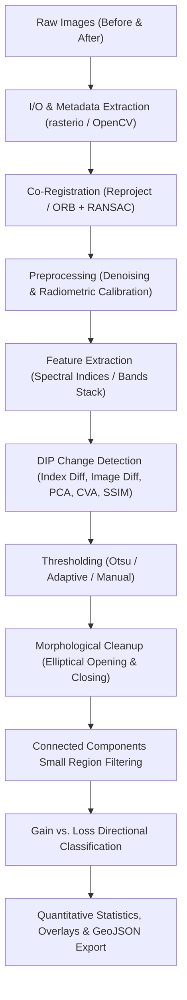

# Image Change Detection using Digital Image Processing for Environmental Monitoring

> **A Classical Digital Image Processing (DIP) Web Application and Analytical Notebook Suite for Earth Observation and Environmental Change Monitoring.**

---

## ?? Project Overview

This project provides an end-to-end platform for monitoring environmental transformations using satellite imagery and classical digital image processing techniques. Users can upload multi-temporal (before and after) satellite imagery of any geographical region, select an environmental application and DIP algorithm, and instantly obtain:
- **Spatial Change Maps & Visual Overlays**
- **Gain vs. Loss Directional Segmentation**
- **Sub-pixel Area Statistics in Square Kilometers ($km^2$) and Percentages**
- **Interactive Leaflet GIS Mapping with WGS84 GeoJSON Export**
- **Comparative Algorithm Benchmarking (Precision, Recall, F1-Score, IoU, Accuracy)**
- **An Optional Random Forest ML Baseline for Pixel Classification**

---

## ?? Environmental Applications & Use Cases

Each environmental monitoring application has its own spectral signature, target change direction, and dedicated theme color:

| Application | Spectral Index | Mathematical Formula | Accent | Primary Change Target |
| :--- | :--- | :--- | :--- | :--- |
| **Deforestation** | **NDVI** (Normalized Difference Vegetation Index) | $\frac{\text{NIR} - \text{Red}}{\text{NIR} + \text{Red}}$ | **Green** (`#22c55e`) | Vegetation Canopy **Loss** ($\Delta \text{NDVI} < 0$) |
| **Water Body Shrinking** | **NDWI** (Normalized Difference Water Index) | $\frac{\text{Green} - \text{NIR}}{\text{Green} + \text{NIR}}$ | **Cyan** (`#06b6d4`) | Surface Water **Loss / Gain** ($\Delta \text{NDWI}$) |
| **Wildfire Burn Scars** | **NBR** (Normalized Burn Ratio) | $\frac{\text{NIR} - \text{SWIR2}}{\text{NIR} + \text{SWIR2}}$ | **Orange/Red** (`#ef4444`) | Charcoal Damage Drop ($\Delta \text{NBR} < 0$) |
| **Urbanization** | **NDBI** (Normalized Difference Built-up Index) | $\frac{\text{SWIR1} - \text{NIR}}{\text{SWIR1} + \text{NIR}}$ | **Purple** (`#a855f7`) | Impervious Built-up **Gain** ($\Delta \text{NDBI} > 0$) |

---

## ?? Dual Input Format Support

The platform automatically identifies the input image structure:

1. **Multi-band GeoTIFFs (Copernicus Browser "Analytical" Download)**:
   - Sentinel-2 L2A BOA (Bottom-of-Atmosphere) surface reflectance.
   - Band Stack Order: `B03` (Green), `B04` (Red), `B08` (NIR), `B11` (SWIR1), `B12` (SWIR2).
   - Preserves Coordinate Reference Systems (CRS) and Affine Transforms.
   - Automated physical reflectance scaling: handles 16-bit raw Digital Numbers ($0-65,535$) and float32 ($0.0-1.0$).
   - Enables all spectral indices, georeferenced pixel area computation, and vector GeoJSON polygon generation.
   - Re-projects multi-temporal grids using `rasterio.warp.reproject`.

2. **Standard Plain RGB / Grayscale Images (PNG / JPG)**:
   - Automatically detected; spectral index differencing is gracefully disabled.
   - Co-registration via OpenCV **ORB** (Oriented FAST and Rotated BRIEF) feature detection and **RANSAC** homography alignment (`cv2.warpPerspective`).
   - Executes Grayscale Image Differencing, PCA, and SSIM Dissimilarity.

---

## ?? Classical Digital Image Processing Pipeline



### Core Algorithms Implemented
1. **Spectral Index Differencing**: $\Delta \text{Index} = \text{Index}_{after} - \text{Index}_{before}$
2. **Image Differencing**: $|\text{Gray}_{after} - \text{Gray}_{before}|$
3. **Principal Component Analysis (PCA) Differencing**: Stacks spectral delta vectors $\Delta b_i$ into matrix $X$, applies PCA to project changes onto the primary eigenvector capturing maximum spectral variance.
4. **Change Vector Analysis (CVA)**: Calculates Euclidean magnitude across spectral dimensions:
   $$M = \sqrt{\sum_{i=1}^C (\text{Band}_{after, i} - \text{Band}_{before, i})^2}$$
5. **Structural Similarity (SSIM Dissimilarity)**: $1 - \text{SSIM}(I_1, I_2)$, highlighting structural texture alterations while remaining resilient to uniform lighting shifts.
6. **Segmentation & Morphological Postprocessing**:
   - **Otsu's Global Binarization**: Maximizes between-class variance $\sigma_B^2$.
   - **Adaptive Gaussian Thresholding**: Calculates localized threshold per pixel neighborhood.
   - **Morphological Opening**: $\text{Mask} \circ B = (\text{Mask} \ominus B) \oplus B$ to eliminate salt noise.
   - **Morphological Closing**: $\text{Mask} \bullet B = (\text{Mask} \oplus B) \ominus B$ to fill holes and bridge micro-fractures.
   - **Small Region Filtering**: `cv2.connectedComponentsWithStats` area thresholding.
7. **Evaluation Metrics**:
   - Precision: $\frac{TP}{TP + FP}$
   - Recall: $\frac{TP}{TP + FN}$
   - F1-Score: $2 \cdot \frac{\text{Precision} \cdot \text{Recall}}{\text{Precision} + \text{Recall}}$
   - IoU (Jaccard Index): $\frac{TP}{TP + FP + FN}$
   - Overall Accuracy: $\frac{TP + TN}{Total}$
8. **Optional Random Forest Baseline**: Supervised pixel classifier using spectral differences, ratios, SSIM dissimilarity, and Laplacian texture gradients.

---

## ?? Project Directory Structure

```text
Environmental_change-_detection_via_satellite_images/
+-- README.md                      # Comprehensive documentation and viva guide
+-- notebooks/                     # 5 Guided Jupyter analytical notebooks
¦   +-- 01_data_exploration.ipynb  # Multi-spectral band inspection and RGB composites
¦   +-- 02_preprocessing.ipynb     # Denoising, histogram matching, and co-registration
¦   +-- 03_indices.ipynb           # NDVI, NDWI, NBR, and NDBI environmental computation
¦   +-- 04_change_detection.ipynb  # 5 DIP algorithms, Otsu thresholding, and morphology
¦   +-- 05_evaluation.ipynb        # Ground truth validation, metrics table, and RF baseline
+-- data/                          # Satellite dataset directory
¦   +-- raw/                       # Raw downloads (deforestation, water, burn_scars, urbanization)
¦   +-- processed/                 # Preprocessed and aligned scenes
¦   +-- ground_truth/              # Binary reference change masks
+-- results/                       # Exported change maps and overlays
+-- docs/                          # Documentation and Viva preparation notes
+-- backend/                       # FastAPI application & DIP services
¦   +-- requirements.txt           # Pinned Python package dependencies
¦   +-- verify_phase1.py           # Phase 1 DIP algorithms test script
¦   +-- verify_phase2_live.py      # Phase 2 FastAPI endpoints test script
¦   +-- verify_phase3.py           # Phase 3 Jupyter notebooks validator
¦   +-- storage/                   # File storage (uploads, outputs, and SQLite database)
¦   ¦   +-- uploads/               # Uploaded image pairs per analysis ID
¦   ¦   +-- outputs/               # Rendered previews, masks, overlays, GeoJSON
¦   ¦   +-- change_detection.db    # SQLite analytical registry
¦   +-- app/                       # Application code
¦       +-- main.py                # FastAPI entry point, CORS, static outputs mount
¦       +-- database.py            # SQLite session management and init_db()
¦       +-- models.py              # SQLAlchemy Analysis table schema
¦       +-- schemas.py             # Pydantic request/response models
¦       +-- routers/               # API endpoints
¦       ¦   +-- analyze.py         # POST /api/analyze, background queue, status polling
¦       ¦   +-- results.py         # GET /api/results, compare, history, usecases, delete
¦       +-- services/              # Pure Digital Image Processing engine
¦           +-- utils.py           # GeoTIFF I/O, georeferencing, synthetic data generator
¦           +-- preprocessing.py   # Denoising, histogram matching, cloud masking
¦           +-- registration.py    # Reprojection & ORB+RANSAC homography alignment
¦           +-- indices.py         # NDVI, NDWI, NBR, NDBI spectral computation
¦           +-- change_detection.py# Index/Image Diff, PCA, CVA, SSIM, thresholding
¦           +-- postprocessing.py  # Morphology, small region removal, stats, GeoJSON
¦           +-- evaluation.py      # Precision, Recall, F1, IoU, RF baseline
+-- frontend/                      # React 18 + Vite modern UI application
    +-- package.json               # Frontend dependencies
    +-- vite.config.js             # Vite configuration with API reverse proxy
    +-- tailwind.config.js         # Dark satellite theme palette
    +-- index.html                 # App shell with Leaflet styles
    +-- src/
        +-- api/client.js          # Axios API communication layer
        +-- components/            # Reusable UI components
        ¦   +-- Navbar.jsx         # Header with live backend connection badge
        ¦   +-- UseCaseCard.jsx    # Environmental application selection card
        ¦   +-- StatCard.jsx       # Animated count-up statistical metric card
        ¦   +-- DropZone.jsx       # Drag & drop upload zone with auto-format detection
        ¦   +-- MethodSelect.jsx   # Multi-band aware algorithm picker
        ¦   +-- CompareSlider.jsx  # Interactive before/after split slider
        ¦   +-- MapView.jsx        # Leaflet GIS map with CartoDB Dark basemap & GeoJSON
        ¦   +-- MetricsTable.jsx   # Algorithm benchmark table with winner badge
        ¦   +-- LoadingOverlay.jsx # Satellite radar sweep progress animation
        ¦   +-- ChangeChart.jsx    # Recharts Gain vs. Loss horizontal bar chart
        +-- pages/                 # Full application pages
            +-- Home.jsx           # Landing hero, feature highlights, use-case cards
            +-- Analyze.jsx        # Upload form, method tuning, advanced DIP settings
            +-- Results.jsx        # Interactive split slider, tabs, statistics, Leaflet GIS
            +-- Compare.jsx        # Side-by-side masks and benchmark metrics
            +-- History.jsx        # Past analyses gallery with overlay thumbnails
```

---

## ?? Quickstart & Setup Guide (PowerShell)

### Prerequisites
- **Python 3.11+** installed
- **Node.js v18+** and **npm** installed

---

### Step 1: Set Up and Start Backend

```powershell
# Navigate to the backend directory
cd C:\CGIP_MP\Environmental_change-_detection_via_satellite_images\backend

# Create and activate virtual environment
python -m venv venv
.\venv\Scripts\Activate.ps1

# Install backend dependencies
pip install -r requirements.txt

# Run the live backend verification script
python verify_phase2_live.py

# Launch the FastAPI server with hot-reload
uvicorn app.main:app --reload --host 127.0.0.1 --port 8000
```
- API Health: [http://127.0.0.1:8000/api/health](http://127.0.0.1:8000/api/health)
- Interactive Swagger UI: [http://127.0.0.1:8000/docs](http://127.0.0.1:8000/docs)

---

### Step 2: Set Up and Start Frontend

Open a second terminal window:

```powershell
# Navigate to the frontend directory
cd C:\CGIP_MP\Environmental_change-_detection_via_satellite_images\frontend

# Install dependencies (if not already done)
npm install

# Start Vite development server
npm run dev
```

Open your browser to: **[http://localhost:5173](http://localhost:5173)**

---

## ?? How to Download Real Sentinel-2 Data from Copernicus Browser

To download multi-spectral satellite imagery for your own area of interest:

1. Visit **[Copernicus Browser](https://browser.dataspace.copernicus.eu/)**.
2. **Search Criteria**:
   - Platform: **Sentinel-2**
   - Product: **L2A** (Bottom-Of-Atmosphere surface reflectance)
   - Max Cloud Coverage: Set slider $\le 10\%$.
3. Locate an area that has experienced change (e.g., forest clearing, reservoir seasonal shrinking, burnt hillsides, or expanding city outskirts).
4. Find two dates (e.g., Year 2022 vs. Year 2026).
5. Click **Download Image**:
   - **For Plain RGB**: Choose the **Basic** tab $\rightarrow$ PNG or TIFF True Color.
   - **For 5-Band Analytical Multi-Spectral Stack**:
     - Switch to the **Analytical** tab.
     - Format: **TIFF (32-bit float)**.
     - Resolution: **HIGH (10m)**.
     - Select Bands: **`B03` (Green), `B04` (Red), `B08` (NIR), `B11` (SWIR1), `B12` (SWIR2)**.
6. Upload the two downloaded TIFFs into the web application under **Analyze**.

*(Note: The synthetic generator included in the project allows running and testing every algorithm without needing any external downloads!)*

---

## ?? Running the Jupyter Notebooks

To explore the image processing algorithms interactively:

```powershell
# Inside backend venv
pip install jupyterlab
jupyter lab
```
Navigate to the `notebooks/` folder:
- `01_data_exploration.ipynb` $\rightarrow$ Multi-spectral channels, georeferencing, False Color IR.
- `02_preprocessing.ipynb` $\rightarrow$ Spatial denoising, histogram matching, cloud masking.
- `03_indices.ipynb` $\rightarrow$ Mathematical computation of NDVI, NDWI, NBR, and NDBI.
- `04_change_detection.ipynb` $\rightarrow$ Image Diff, PCA, CVA, SSIM, Otsu thresholding, morphology.
- `05_evaluation.ipynb` $\rightarrow$ Precision, Recall, F1, IoU, grouped bar chart, and Random Forest baseline.

---

## ?? College Viva & Examination Q&A Cheat Sheet

**Q1: Why use classical Digital Image Processing instead of Deep Learning?**
> *Answer*: Deep learning models are computationally heavy, require thousands of manually annotated satellite training masks, and act as unexplainable "black boxes". Classical DIP techniques (spectral indexing, PCA, CVA, Otsu binarization, morphological filtering) are mathematically rigorous, deterministic, physically grounded in remote sensing physics, operate with zero training overhead, and execute rapidly on CPU.

**Q2: What is the physical principle behind NDVI?**
> *Answer*: Healthy green vegetation absorbs Red light ($665\text{ nm}$) via chlorophyll for photosynthesis, while the spongy mesophyll leaf structure strongly reflects Near-Infrared ($842\text{ nm}$) to prevent overheating. Deforestation causes NIR reflectance to collapse and bare soil Red reflectance to rise, producing a steep decline in $\text{NDVI} = \frac{\text{NIR} - \text{Red}}{\text{NIR} + \text{Red}}$.

**Q3: Why is histogram matching necessary before differencing?**
> *Answer*: Two satellite scenes captured on different dates have differing sun elevation angles, atmospheric haze, and seasonal illumination. Simple subtraction would trigger false change alerts on every pixel. Histogram matching maps the cumulative distribution function (CDF) of the target scene to the reference scene, normalizing baseline brightness.

**Q4: How does PCA Differencing work?**
> *Answer*: We compute delta images for each spectral band and stack them into an $N \times C$ matrix. PCA computes the covariance matrix and finds orthogonal eigenvectors. The primary principal component aligns with the axis of greatest multi-spectral variance—which corresponds to physical land-cover changes rather than background sensor noise.

**Q5: What do morphological opening and closing accomplish?**
> *Answer*: Raw thresholding produces speckle noise (isolated pixels). Morphological **Opening** (erosion followed by dilation) eliminates small isolated false-positive pixels. Morphological **Closing** (dilation followed by erosion) bridges micro-gaps within contiguous change patches and fills interior pinholes.
